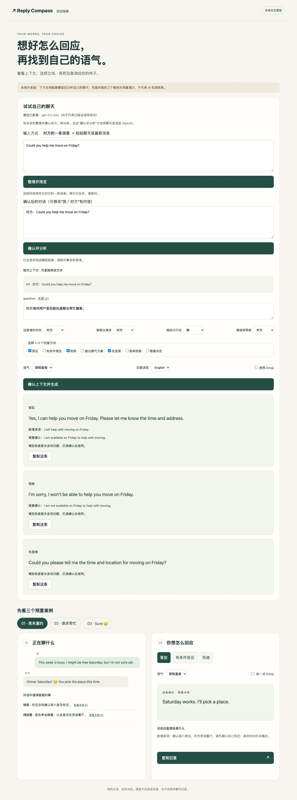

# Reply Compass

A local AI reply assistant that turns a conversation into reviewable context, then suggests replies with different intentions, tone and emoji preferences.

[中文说明](README.zh-CN.md)

## Try the workflow

Paste a two-person conversation or a single incoming message → confirm speaker identity → review source-linked facts, questions and roles → choose up to three reply directions → inspect suggestions, commitments and model warnings → copy a reply.



## What this project demonstrates

- **Input design:** deterministic, local normalization accepts named messages and optional bracketed timestamps. Explicit identity confirmation avoids guessing who is speaking. A single incoming message works without role labels.
- **Structured AI integration:** a Python API validates structured model outputs and message references; users can correct context and who requests, performs and receives an action before generation.
- **Controllable replies:** intent is separate from tone and emoji use. Candidates expose introduced commitments and assumptions for review. Nothing is sent automatically.
- **Evaluation and engineering judgment:** reproducible checker comparisons, documented failure cases and resource-bounded sequential evaluations. Experimental checkers are kept separate from the production prompt.

## Run locally

Python 3.10+; no third-party runtime dependencies.

```sh
git clone https://github.com/zbchen0129-crypto/reply-compass.git
cd reply-compass
python3 scripts/configure_local.py
python3 server.py
```

Open http://127.0.0.1:8765. The configuration script prompts for your own API key without echoing it and saves a local `.env` with owner-only permissions. Existing environment variables take precedence. You can skip configuration and explore the three handwritten demos; those demos are not model-generated evaluation results.

Chat normalization stays local. **Confirm and analyze** sends the reviewed conversation to OpenAI. Analysis uses one model call; generation uses two (generation plus checking) and may incur charges. The application does not persist chat; requests use `store: false`, which is not a guarantee of zero provider retention. Keep `.env` and private chats out of Git.

## Architecture

Vanilla JavaScript UI → Python standard-library HTTP API → local parser / structured extraction → human context review → reply generation → independent model check.

- `chat_input.py`: local normalization and speaker mapping.
- `core.py`: contracts, reference validation and model pipeline.
- `server.py`: loopback-only server, request-size limits, host/origin checks and static-file allowlist.
- `checker_dimensions.py`, `checker_evidence.py`: experimental checkers, not production replacements.
- `tests/`, `evals/`, `evidence/`: automated checks, synthetic cases and recorded results.

## Validation and limitations

```sh
python3 -m unittest discover -s tests -v
```

47 automated tests passed on November 24, 2026. One synthetic single-message browser run completed extraction, generation and checking with three sequential calls to `gpt-4.1-mini`. This establishes an integration result, not an accuracy estimate.

In a 12-case checker comparison (six intentionally invalid and six valid replies), the production baseline detected 3/6 invalid replies with 0/6 false positives. An evidence-ledger experiment detected 4/6 with 1/6 false positives. It was **not promoted**. See the [comparison review](evidence/checker-evidence-review-2026-11-16.md) and [development log](docs/development-log.md).

Known limitations include role reversals, missed inconsistencies and false alarms. There is no measured quality advantage over a direct-prompt baseline. Message references establish provenance IDs, not semantic proof. Group chats, screenshots and arbitrary platform exports are not supported. This is a local single-user portfolio prototype, not a production messaging service or hosted demo.

Evaluation runners bound input and response sizes, case counts and model calls; comparisons run sequentially with a 192 MiB process-memory stop threshold. No live API calls are needed for the unit suite.
